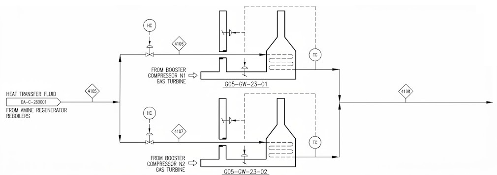
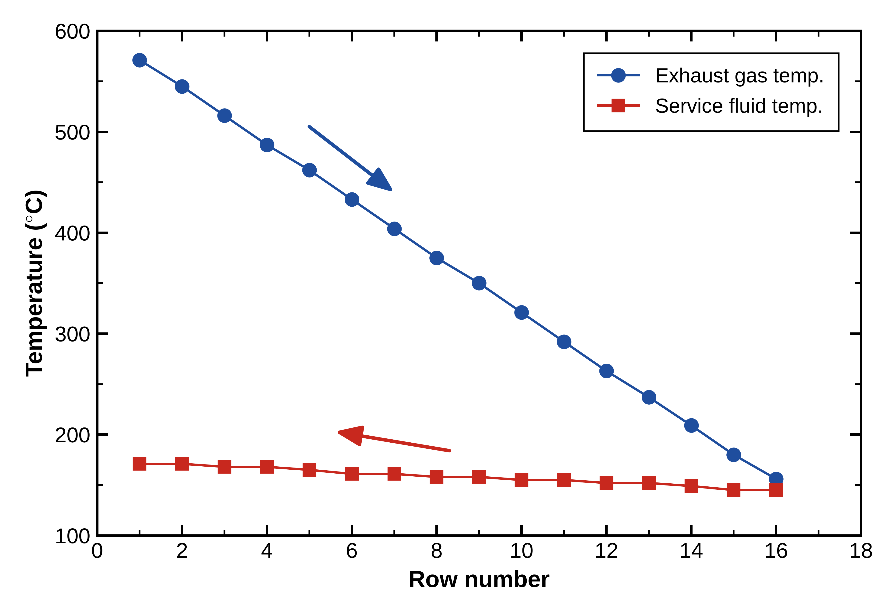
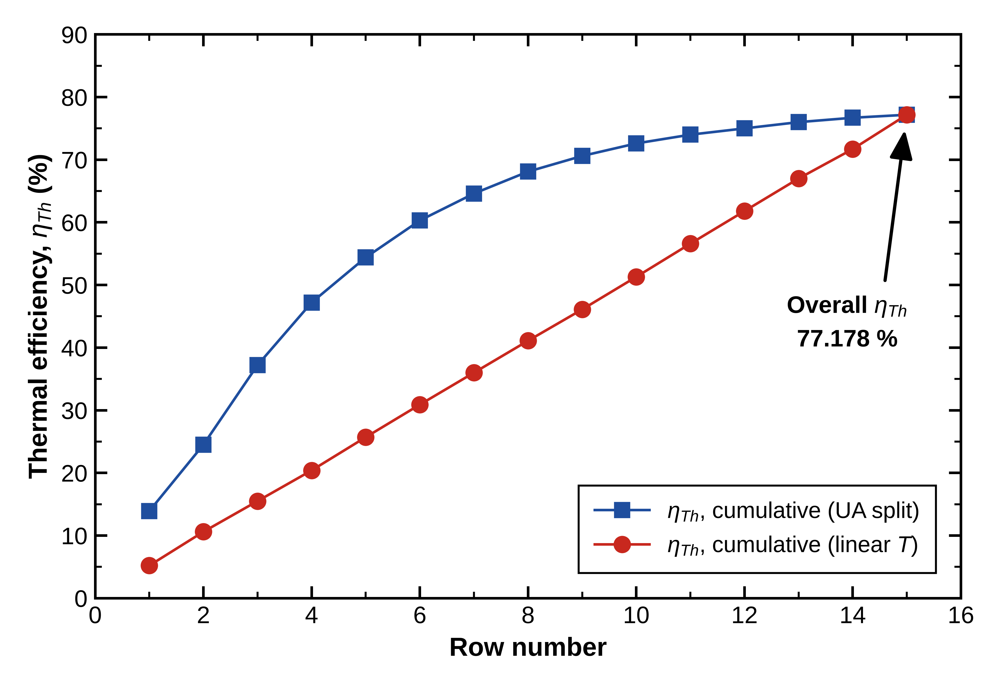

[English](README.md) | [Deutsch](README.de.md) | [Français](README.fr.md)

# Rigorose Modellierung der Abhitzerückgewinnungseinheiten G05-GW-23-01 und 02 an den Booster-Gasverdichtern (Excel), Zentrale Erdgasaufbereitungsanlage Rhourde-Nouss, Südosten Algeriens

**Zentrale Erdgasaufbereitungsanlage Rhourde-Nouss, Südosten Algeriens**

  
   
  <em>Abbildung 1: Abhitzerückgewinnungseinheiten G05-GW-23-01 und 02 an den Booster-Gasverdichtern, schematische Darstellung (nicht maßstäblich).</em>

## Übersicht
Thermisches ε-NTU-Modell auf Basis physikalischer Grundgleichungen (First-Principles-Modell) einer 16-reihigen industriellen Abhitzerückgewinnungseinheit (WHRU). Die Einheit nutzt die Abgase der Booster-Gasverdichterturbinen, um das Wärmeträgeröl TORADA TC 32 zu erhitzen. Dieses speist die Konvektionszone des vertikal-zylindrischen Wärmeträgeröl-Röhrenofens 480-FA-41-01, der die Reboiler der Regeneratorkolonne der CO₂-Abtrennungsanlage (AGRU) versorgt.

Das Modell kombiniert gasseitig die Korrelationen von Weierman/ESCOA für gezackte Rippen mit den inneren Filmwärmeübergangskoeffizienten nach Gnielinski auf der Ölseite. Es wurde verwendet, um das Wärmeübertragungsverhalten der Einheit anhand der Auslegungsdaten des Herstellers zu überprüfen.

## Prozesskontext
- **Wärmequelle:** Abgase der Booster-Gasverdichterturbinen.
- **Erhitztes Medium:** Wärmeträgeröl TORADA TC 32, das in den Rohren strömt.
- **Ziel:** Konvektionszone des Röhrenofens 480-FA-41-01, anschließend die Aminregenerator-Reboiler der AGRU.

## Modellbeschreibung

### Gasseite
- Abschätzung der Abgaseigenschaften.
- Gasseitiger Wärmeübergangskoeffizient, für jeden geometrischen Abschnitt der Austauschfläche modelliert, mit den **Weierman/ESCOA-Korrelationen für gezackte Rippen**.

### Ölseite
- Innerer Filmwärmeübergangskoeffizient des in den Rohren strömenden Öls, geschätzt mit der **Gnielinski-Korrelation**.

### Thermisches Modell
- **ε-NTU-Methode**, reihenweise auf die 16-reihige Einheit angewendet.
- Gesamte berippte (erweiterte) Austauschfläche, berechnet aus der Rohr- und Rippengeometrie.
- Gesamtwärmeleistung, Öl-Rücklauftemperatur und thermischer Gesamtwirkungsgrad (ηTh) werden vom Modell berechnet.
- Zwei Temperaturprofilfälle im Vergleich: eine **UA-Aufteilung** mit reihenspezifischem UA und ein **linearer Temperaturverlauf**.

## Validierung anhand der Auslegungsdaten des Herstellers
| Parameter | Modell | Herstellerauslegung | Abweichung (%) |
|---|---|---|---|
| Gesamte berippte (erweiterte) Fläche (m²) | 3241,75 | 3240 | 0,05 |
| Gesamtwärmeleistung (MW) | 12,68 | 12,5 | 1,45 |
| Öl-Rücklauftemperatur (°C) | 167,67 | 167 | 0,4 |

**Modellergebnis:** thermischer Gesamtwirkungsgrad ηTh = 77,2 %.

## Ergebnisse

  
   
  <em>Abbildung 2: Abhitzerückgewinnungseinheiten G05-GW-23-01 und 02, Temperaturprofile des Modells.</em>

  
   
  <em>Abbildung 3: Kumulativer reihenweiser thermischer Wirkungsgrad ηTh für die Fälle UA-Aufteilung und linearer Temperaturverlauf.</em>

Das Diagramm in Abbildung 3 zeigt, wie sich der kumulative thermische Wirkungsgrad Reihe für Reihe aufbaut, bis er den thermischen Gesamtwirkungsgrad von ηTh = 77,2 % erreicht.

## Werkzeuge
Microsoft Excel (Berechnungen), OriginLab (Diagramme)

## Kompetenzen
Abhitzerückgewinnungseinheiten - Wärmeübertrager-Modellierung und thermische Auslegung - Prozess- und thermodynamische Analyse - Erdgasaufbereitung

## Hinweise

Die Eingangsdaten wurden bereinigt; es sind keine vertraulichen Anlagen- oder Herstellerdaten enthalten.

*Dieses Repository ist lediglich eine Vorschau einiger Ergebnisse des in Excel entwickelten Modells (es ist keine Arbeitsmappe beigefügt).*
