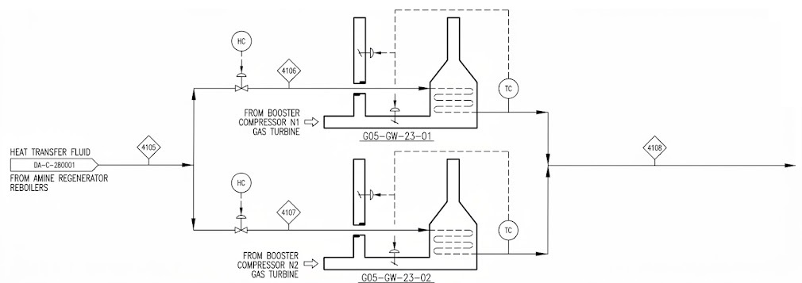
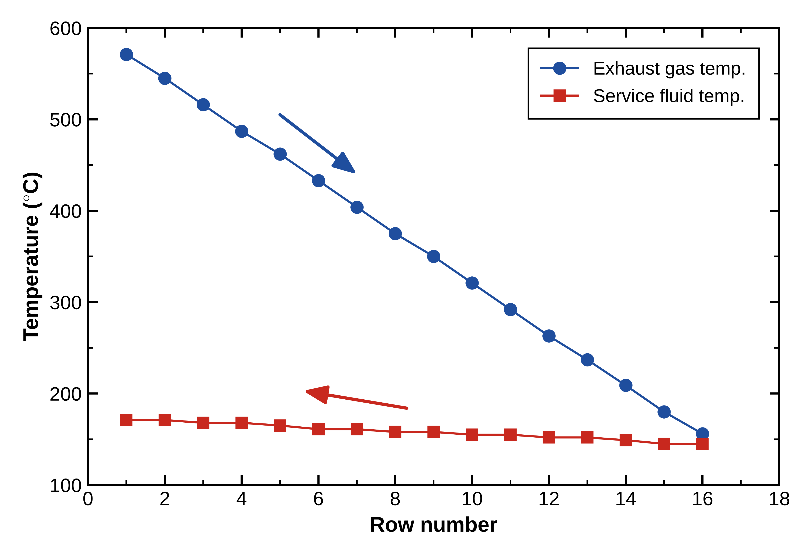
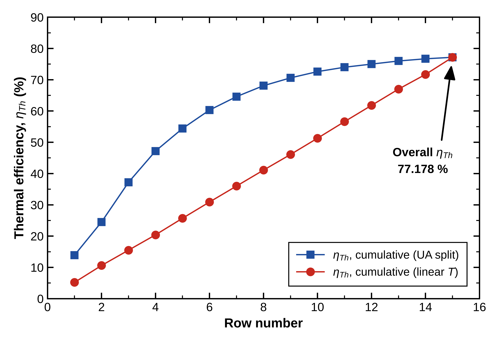

[English](README.md) | [Deutsch](README.de.md) | [Français](README.fr.md)

# Modélisation rigoureuse des unités de récupération de chaleur fatale G05-GW-23-01 et 02 des compresseurs de gaz booster (Excel), installation centrale de traitement du gaz naturel de Rhourde-Nouss, Sud-Est de l'Algérie

**Installation centrale de traitement du gaz naturel de Rhourde-Nouss, Sud-Est de l'Algérie**

  
   
  <em>Figure 1 : Unités de récupération de chaleur fatale G05-GW-23-01 et 02 des compresseurs de gaz booster, vue schématique (non à l'échelle).</em>

## Aperçu
Modèle thermique ε-NTU fondé sur les principes physiques fondamentaux d'une unité industrielle de récupération de chaleur fatale (WHRU) à 16 rangées. L'unité utilise les gaz d'échappement des turbines des compresseurs de gaz booster pour chauffer l'huile caloporteuse TORADA TC 32, qui alimente la zone convective du four cylindrique vertical de chauffage d'huile caloporteuse 480-FA-41-01, lequel approvisionne les rebouilleurs de la colonne de régénération de l'unité de décarbonatation (AGRU).

Le modèle combine, côté gaz, les corrélations de Weierman/ESCOA pour ailettes dentelées avec les coefficients de film interne de Gnielinski côté huile. Il a servi à auditer le comportement de transfert thermique de l'unité par rapport aux données de conception du fournisseur.

## Contexte du procédé
- **Source de chaleur :** gaz d'échappement des turbines des compresseurs de gaz booster.
- **Fluide chauffé :** huile caloporteuse TORADA TC 32, circulant à l'intérieur des tubes.
- **Destination :** zone convective du four 480-FA-41-01, puis rebouilleurs du régénérateur d'amine de l'AGRU.

## Description du modèle

### Côté gaz
- Estimation des propriétés des gaz d'échappement.
- Coefficient de transfert thermique côté gaz modélisé pour chaque section géométrique de la surface d'échange, à l'aide des **corrélations de Weierman/ESCOA pour ailettes dentelées**.

### Côté huile
- Coefficient de transfert thermique du film interne de l'huile circulant dans les tubes, estimé avec la **corrélation de Gnielinski**.

### Modèle thermique
- **Méthode ε-NTU** appliquée rangée par rangée à l'unité à 16 rangées.
- Surface d'échange ailetée (étendue) globale, calculée à partir de la géométrie des tubes et des ailettes.
- Charge thermique totale, température de retour de l'huile et rendement thermique global (ηTh) calculés par le modèle.
- Deux cas de profil de température comparés : une **répartition du UA** avec un UA propre à chaque rangée, et un **profil linéaire de température**.

## Validation par rapport aux données de conception du fournisseur
| Paramètre | Modèle | Conception du fournisseur | Écart (%) |
|---|---|---|---|
| Surface ailetée (étendue) globale (m²) | 3241,75 | 3240 | 0,05 |
| Charge thermique totale (MW) | 12,68 | 12,5 | 1,45 |
| Température de retour de l'huile (°C) | 167,67 | 167 | 0,4 |

**Résultat du modèle :** rendement thermique global ηTh = 77,2 %.

## Résultats

  
   
  <em>Figure 2 : Unités de récupération de chaleur fatale G05-GW-23-01 et 02, profils de température du modèle.</em>

  
   
  <em>Figure 3 : Rendement thermique ηTh cumulé rangée par rangée pour les cas de répartition du UA et de profil linéaire de température.</em>

Le graphique de la figure 3 montre comment le rendement thermique cumulé se construit rangée après rangée jusqu'à atteindre le rendement thermique global ηTh = 77,2 %.

## Outils
Microsoft Excel (calculs), OriginLab (graphiques)

## Compétences
Unité de récupération de chaleur fatale - Modélisation d'échangeurs de chaleur et conception thermique - Analyse des procédés et thermodynamique - Traitement du gaz naturel

## Remarques

Les données d'entrée ont été assainies ; aucune donnée confidentielle d'usine ou de fournisseur n'est incluse.

*Ce dépôt n'est qu'un aperçu de quelques résultats du modèle développé sous Excel (aucun classeur n'est joint).*
