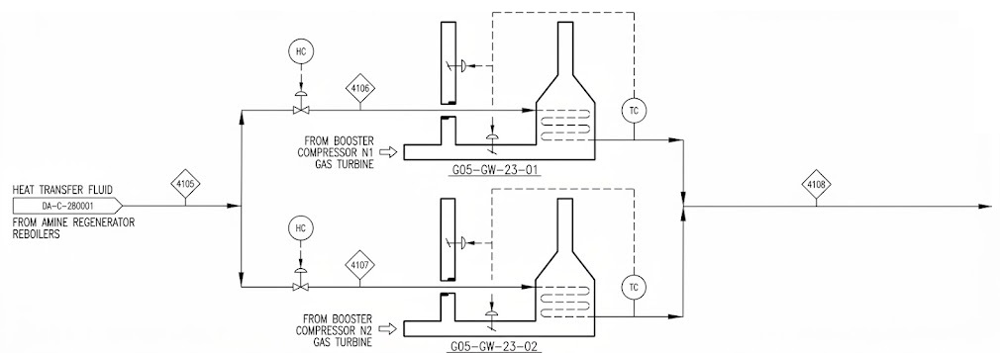
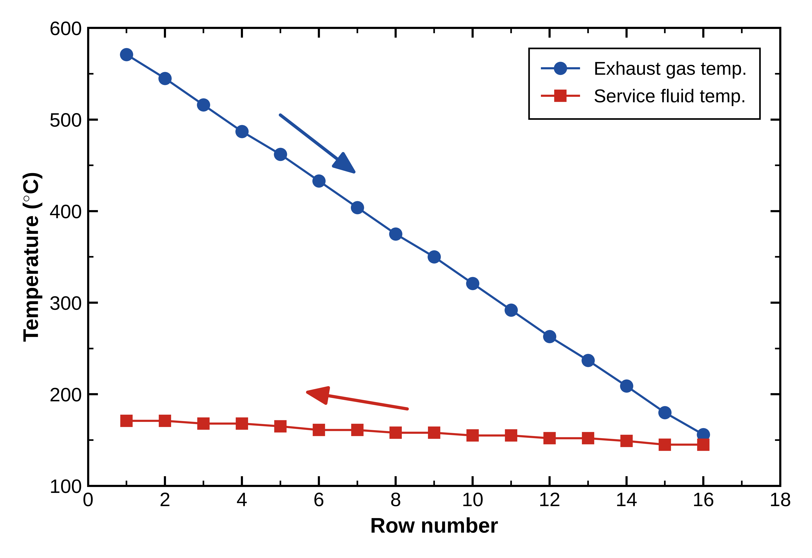
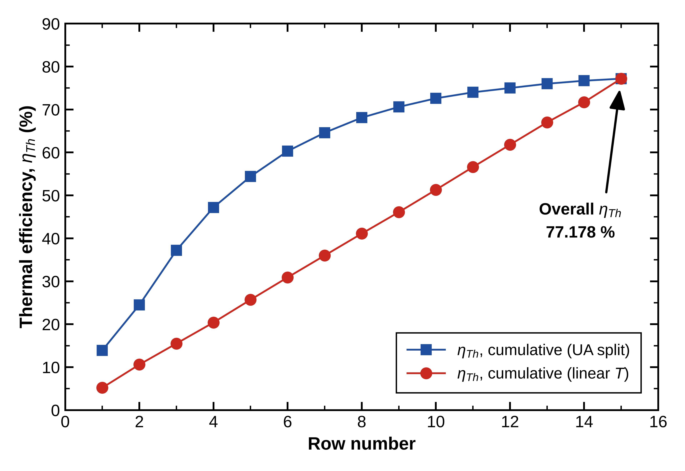

# Rigorous Modeling of the G05-GW-23-01 and 02 Waste Heat Recovery Units from Booster Gas Compressors (Excel), Rhourde-Nouss Natural Gas Central Processing Facility, Southeastern Algeria

**Rhourde Nouss Natural Gas Central Processing Facility, Southeastern Algeria**

  
   
  <em>Figure 1: G05-GW-23-01 and 02 Waste Heat Recovery Units from Booster Gas Compressors, schematic view (not to scale).</em>

## Overview
First-principles ε-NTU thermal model of a 16-row industrial Waste Heat Recovery Unit (WHRU). The unit uses the exhaust gases of the booster gas compressor turbines to heat TORADA TC 32 thermal oil, which feeds the convection section of the 480-FA-41-01 vertical cylindrical hot oil heating fired heater supplying the Acid Gas Removal Unit (AGRU) regenerator column reboilers.

The model combines Weierman/ESCOA serrated fin correlations on the gas side with Gnielinski internal film coefficients on the oil side, and was used to audit the heat transfer behavior of the unit against vendor design data.

## Process Context
- **Heat source:** exhaust gases of the booster gas compressor turbines.
- **Heated fluid:** TORADA TC 32 thermal oil, flowing inside the tubes.
- **Destination:** convection section of the fired heater 480-FA-41-01, then the AGRU amine regenerator reboilers.

## Model Description

### Gas Side
- Estimation of the exhaust gas properties.
- Gas-side heat transfer coefficient modeled for each geometrical section of the exchange area, using the **Weierman/ESCOA serrated fin correlations**.

### Oil Side
- Internal film heat transfer coefficient for the oil flowing inside the tubes, estimated with the **Gnielinski correlation**.

### Thermal Model
- **ε-NTU method** applied row by row to the 16-row unit.
- Overall Extended (Finned) Exchange Area calculated from the tube and fin geometry.
- Total Thermal Duty, Oil Return Temperature and Overall Thermal Efficiency (ηTh) predicted by the model.
- Two temperature profile cases compared: a **UA split** with row-specific UA, and a **linear temperature profile**.

## Validation Against Vendor Design Data
| Parameter | Model | Vendor design | Deviation (%) |
|---|---|---|---|
| Overall Finned (Extended) Area (m²) | 3241.75 | 3240 | 0.05 |
| Total Thermal Duty (MW) | 12.68 | 12.5 | 1.45 |
| Oil Return Temperature (°C) | 167.67 | 167 | 0.4 |

**Model result:** overall thermal efficiency ηTh = 77.2 %.

## Results

  
   
  <em>Figure 2: G05-GW-23-01 and 02 Waste Heat Recovery Units, model temperature profiles.</em>

  
   
  <em>Figure 3: Cumulative row-by-row ηTh thermal efficiency for the UA split and linear temperature profile cases.</em>

The plot in Figure 3 shows how the cumulative thermal efficiency builds up over each row until it reaches the overall thermal efficiency of ηTh = 77.2 %.

## Tools
Microsoft Excel (Calculations), OriginLab (Plots)

## Skils
Waste Heat Recovery Unit - Heat Exchanger Modeling and Thermal Design - Process and Thermodynamic Analysis - Natural Gas Processing - 

## Notes

Inputs are sanitized; no confidential plant or vendor data is included.

*This repository is only a preview of some results from the model developed in Excel (no workbook is attached).*
